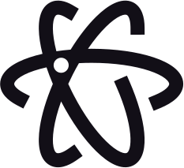
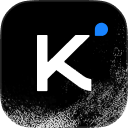

[English](README.md) · [한국어](README.ko.md) · [简体中文](README.zh-CN.md) · [Français](README.fr.md) · **Deutsch**

<p align="center">
  <picture>
    <source media="(prefers-color-scheme: dark)" srcset="assets/taste-skill-wordmark-dark.png" />
    
  </picture>
</p>

<p align="center">
  <a href="https://tasteskill.dev" title="tasteskill.dev besuchen"></a>
  &nbsp;
  <a href="https://tastecode.dev" title="tastecode.dev besuchen"></a>
  &nbsp;
  <a href="LICENSE"></a>
  &nbsp;
  <a href="CHANGELOG.md"></a>
</p>

<p align="center">
  <a href="https://tastecode.dev">
    <picture>
      <source media="(prefers-color-scheme: dark)" srcset="assets/readme-tastecode-dark.webp" />
      
    </picture>
  </a>
</p>

<h3 align="center">Sponsoren</h3>

<table align="center">
  <tr>
    <td align="center" width="104">
      <a href="https://interfaces.dev/?utm_source=tasteskill&utm_medium=sponsorship">
        
      </a>
    </td>
    <td><sub><a href="https://interfaces.dev/?utm_source=tasteskill&utm_medium=sponsorship"><strong>interfaces.dev</strong></a> · Ein Magazin für Design Engineering von <a href="https://github.com/jakubkrehel"><strong>Jakub Krehel</strong></a></sub></td>
  </tr>
  <tr>
    <td align="center" width="104">
      <a href="https://reactbits.dev">
        <picture>
          <source media="(prefers-color-scheme: dark)" srcset="assets/sponsors/reactbits-icon-dark.svg" />
          
        </picture>
      </a>
    </td>
    <td><sub><a href="https://reactbits.dev"><strong>React Bits</strong></a> · animierte React-Komponenten für kreative Oberflächen</sub></td>
  </tr>
  <tr>
    <td align="center" width="104"><a href="https://img.ly/"></a></td>
    <td><sub><a href="https://img.ly/"><strong>IMG.LY</strong></a> · CreativeEditor SDK</sub></td>
  </tr>
  <tr>
    <td align="center" width="104"><a href="https://www.sent.dm"></a></td>
    <td><sub><a href="https://www.sent.dm"><strong>Sent.dm</strong></a> · Messaging-APIs für SMS, WhatsApp und RCS</sub></td>
  </tr>
</table>

<p align="center"><sub><a href="https://github.com/sponsors/Leonxlnx">Sponsor werden</a></sub></p>

**Taste Skill** (`tasteskill 2.5.2`) ist ein Agent Skill, mit dem Coding-Agenten professionelle Firmenwebsites auf dem Niveau von `figma.com` und `x.ai` bauen, statt eine generische Landingpage zusammenzusetzen. Jeder Build verwendet schlichte Texte, ein einziges Designsystem, einen Abschnitt pro Bildschirm, gleich große Ränder links und rechts, echte Fotografien (lizenzierte Platzhalter, wenn der Kunde keine hat), echte Markenicons und echte Produkt-UI, einen Hero-Auftritt und ein bis zwei gezielt gesetzte Momente auf jeder Seite, dezente Mikrointeraktionen sowie Shader-Effekte und Scroll-Szenen, die streng Tech-, Gaming- und Software-Seiten vorbehalten sind. Alles wird in einem echten Browser von einem Checker und einem Finish-Gate geprüft, die die Regeln durchsetzen.

Seiten, die in früheren v2-Läufen aus einem einzigen Briefing entstanden sind:

<table>
  <tr>
    <td width="50%"></td>
    <td width="50%"></td>
  </tr>
  <tr>
    <td width="50%"></td>
    <td width="50%"></td>
  </tr>
</table>

Die Fotografien sind echt, stammen aus offenen Archiven und werden vom Skill mit Quellenangabe versehen ([Bildnachweise](examples/v2/CREDITS.md)). Sieh dir den [Launch-Film](https://github.com/Leonxlnx/taste-skill/releases/tag/v2.0.0) an.

## Installation

```bash
npx skills add https://github.com/Leonxlnx/taste-skill --skill "design-taste-frontend"
```

Damit wird der Skill mit der CLI [`npx skills`](https://github.com/vercel-labs/agent-skills) installiert.

Der Skill führt seine Skripte mit **Node 22+** und einem installierten **Chrome, Edge oder Chromium** aus (setze `CHROME_PATH`, wenn der Browser an einem nicht üblichen Ort liegt). Optional: **ffmpeg** im PATH, für die WebP-Ausgabe und den Smartphone-Ausschnitt einer Hero-Fotografie in `photos.mjs`. Der Skill installiert nichts und braucht keine API-Schlüssel. Mitgelieferte Fotografien von Wikimedia Commons funktionieren offline; für das Laden weiterer Fotografien oder Icons wird eine Netzwerkverbindung genutzt.

<details>
<summary>Claude-Code-Plugin</summary>

Führe diese Befehle in Claude Code aus. Der Skill liegt im Namensraum `taste-skill:` und kollidiert deshalb nicht mit deinen anderen Skills.

```
/plugin marketplace add Leonxlnx/taste-skill
/plugin install taste-skill@taste-skill
```

Mit `/plugin update` aktualisierst du ihn später. Auf claude.ai lädst du das ZIP des Repositorys (**Code > Download ZIP** auf GitHub) unter **Customize > Plugins > Add > Upload plugin** hoch.

</details>

<details>
<summary>Codex-Plugin</summary>

```bash
codex plugin marketplace add Leonxlnx/taste-skill
codex plugin add taste-skill@taste-skill
```

Starte danach eine neue Codex-Sitzung, damit der Skill geladen wird.

</details>

<details>
<summary>Aus einem Klon, verlinkt statt kopiert</summary>

`./install.sh` legt den Skill per Symlink in Claude Code ab (`--codex` für Codex, `--all-agents` für beide), sodass ein `git pull` ihn an Ort und Stelle aktualisiert. Unter Windows (Git Bash) erzeugt das Skript einen echten Link oder, wenn Symlinks nicht erlaubt sind, eine Directory Junction. Einen älteren kopierten Ordner meldet es, statt ihn stillschweigend zu überspringen.

</details>

Du hast den Skill schon? Führe den Installationsbefehl einfach erneut aus; der Installationsname hat sich nicht geändert. Du suchst einen der älteren Skills? Siehe [Verschobene Skills](#verschobene-skills).

## So funktioniert 2.5

Du nutzt ihn, indem du deinen Agenten bittest, eine Firmenwebsite zu bauen oder neu zu gestalten; der Agent lädt den Skill, kopiert `assets/` ins Projekt, beginnt mit `assets/starter.html` und führt den Checker aus, bevor er die Seite übergibt. Jeder Build beginnt damit, das Geschäft des Kunden einzuordnen (`software`, `gaming`, `tech`, `product`, `service` oder `place`) und die Seite Bildschirm für Bildschirm zu planen, bevor Markup geschrieben wird:

1. **Tokens und Layout austeilen.** `scripts/start.mjs` teilt eine zur Branche passende Palette und eine Google-Fonts-Kombination für die Seitenart aus (`library/palettes.json`, `library/type.json`), und `assets/layout/deal.mjs` teilt ein Hero-Layout aus (`split`, `centred`, `product`, `photo`, `place`, `collage`, `editorial`, `word`, `film`, `statement` oder `triptych`).
2. **Mit einem System beginnen.** `assets/starter.html`, `assets/system.css` und `assets/layout/layout.css` erzwingen auf dem Desktop (`1440x900`) einen Abschnitt pro Bildschirm, gleiche Inhaltsränder links und rechts, eine feste Navigationsleiste und einen Abschluss-Footer über einen ganzen Bildschirm (`footer.closing`).
3. **Echte Produkt-UI und echte Fotografien zeigen.** Software- und Tech-Seiten füllen beleuchtete Feature-Karten (`assets/ui/cards.css`) mit neu geschriebenen HTML-UI-Fragmenten (`assets/ui/`) und Knoten-Linien-Diagrammen (`assets/diagrams/`), mit echten Marken- und Oberflächen-SVGs, die `scripts/icons.mjs` lokal auflöst. Seiten für Orte, Shops, Gastgewerbe und nicht technische Produkte setzen auf kuratierte Fotografien (`scripts/photos.mjs`, `assets/photos/`), Typografie und flache Farbe und nennen die Quellen in einer einzigen aufklappbaren Footer-Zeile, ohne Bildunterschriften unter den Bildern.
4. **Effekte für Tech- und Gaming-Seiten aufheben.** Shader-Hintergründe (`scripts/effects.mjs`), Scroll-Szenen (`assets/scenes/`) und prozedurale 3D-Drucke (`assets/objects/`) werden nur auf `software`-, `tech`- und `gaming`-Seiten ausgeteilt, innerhalb einer Obergrenze von vier WebGL-Kontexten, mit statischen Fallbacks für Smartphones und reduzierte Bewegung. Jede Seite bekommt einen Hero-Auftritt und ein bis zwei Momente aus `scripts/moments.mjs`; Cafés, Hotels, Shops, Studios und Dienstleister bekommen nur die foto- und typografiegeführten, und kein WebGL.
5. **In einem echten Browser über HTTP prüfen.** `scripts/consistency.mjs`, `assets/layout/check.mjs`, `scripts/perf.mjs` und `scripts/shoot.mjs` rendern die gebaute Seite in Headless Chrome bei `1440`, `1024`, `768` und `390` und finden leere Visuals, defekte Shader, Kontrastverluste, versetzte Spalten, abweichende Abschnittshöhen, Platzhaltertexte, erfundene Hausnummern und Bildlücken bei langsamer Verbindung, bevor der Build ausgeliefert wird. `scripts/gate.mjs` hält den Abschluss dann zurück, bis kein behebbares FAIL mehr übrig ist, höchstens drei Runden lang.

Was sich gegenüber `2.1.x` geändert hat, steht im [Changelog](CHANGELOG.md).

## Die Werkzeuge

Alles sind schlichte Node-22+-Skripte im Skill-Ordner; keines installiert etwas.

| Werkzeug | Was es tut |
| --- | --- |
| `scripts/start.mjs` | Teilt eine Palette und eine Google-Fonts-Kombination für die Seitenart aus und gibt die `<head>`-Links und die `:root`-Tokens aus. |
| `assets/layout/deal.mjs` | Teilt eines von elf getesteten Hero-Layouts aus; `assets/layout/check.mjs` prüft es mit Stresstests für lange Überschriften. |
| `scripts/photos.mjs` | Teilt geprüfte Fotografien nach Branche aus, setzt das Bildgewicht durch und schreibt die eine Quellenzeile im Footer. |
| `scripts/icons.mjs` | Löst echte Marken- und Oberflächen-Icons in lokale SVG-Dateien auf. |
| `scripts/effects.mjs`, `scripts/moments.mjs` | Teilen Shader-Hintergründe für Tech-, Gaming- und Software-Seiten aus, und die Momente für jede Art. |
| `scripts/gate.mjs`, `scripts/copy-lint.mjs` | Das Finish-Gate (auch ein Stop-Hook) und der Copy-Linter, den es ausführt. |
| `scripts/consistency.mjs` | Der Checker: rendert die Seite in Headless Chrome über HTTP bei `1440`, `1024`, `820`, `768` und `390` und gibt pro Regel PASS, WARN oder FAIL aus. |
| `scripts/perf.mjs`, `scripts/shoot.mjs` | Seitengewicht und Geschwindigkeit sowie Screenshots der ganzen Seite und einzelner Abschnitte. |

Erster Lauf, aus dem Projektordner (ein Deal schaltet dort auch das Finish-Gate scharf): `node scripts/start.mjs deal --page software` (Arten: `software`, `gaming`, `tech`, `product`, `service`, `place`). Eine gebaute Seite prüfst du mit `node scripts/consistency.mjs <url or file> --page <kind>`.

## Verschobene Skills

Dieses Repository enthält einen Skill, `design-taste-frontend`. Die anderen sind in eigene Repositories umgezogen und haben ihre Installationsnamen behalten:

| Installationsname | Wo er jetzt liegt |
| --- | --- |
| `high-end-visual-design`, `minimalist-ui`, `industrial-brutalist-ui`, `gpt-taste`, `stitch-design-taste`, `design-taste-frontend-v1`, `design-taste-frontend-v2-experimental` | **[Leonxlnx/taste-skill-classics](https://github.com/Leonxlnx/taste-skill-classics)** |
| `imagegen-frontend-web`, `imagegen-frontend-mobile`, `brandkit`, `image-to-code` | **[Leonxlnx/imagegen-skills](https://github.com/Leonxlnx/imagegen-skills)** |
| `redesign-existing-projects` | Teil von `design-taste-frontend`, das eine bestehende Seite in einem echten Browser prüft, bevor es etwas ändert |
| `full-output-enforcement` | Entfernt. Für dasselbe Problem siehe **[Leonxlnx/unlazy](https://github.com/Leonxlnx/unlazy)** |

Installiere einen verschobenen Skill unter demselben Namen aus seinem neuen Repository:

```bash
npx skills add https://github.com/Leonxlnx/taste-skill-classics --skill "high-end-visual-design"
```

## Häufige Fragen

**Was braucht der Skill?**  
Node 22 oder neuer sowie Chrome, Edge oder Chromium; ffmpeg ist optional (WebP-Fotografien und der Smartphone-Ausschnitt einer Hero-Fotografie). Er installiert nichts und verwendet keine API-Schlüssel. Mitgelieferte Commons-Fotografien liegen lokal; eine Netzwerkverbindung wird nur genutzt, wenn weitere Fotografien, Google Fonts oder Markenicons heruntergeladen werden.

**Woher stammen die Bilder, und darf ich sie verwenden?**  
Aus der geprüften Fotobibliothek des Skills (`assets/photos/photos.json`, darunter mitgelieferte WebP-Sets von Wikimedia Commons und Unsplash-Fotografien), die `scripts/photos.mjs` austeilt. Bilder aus der Bibliothek werden für Details zu Branche und Material verwendet (oder ausdrücklich als Platzhalter im Entwurf gekennzeichnet, wenn der Kunde noch keine Fotografien hat), nie als der eigene Raum, das eigene Personal oder das eigene Produkt des Kunden ausgegeben und in einer einzigen aufklappbaren Footer-Zeile mit Quelle genannt (`photos.mjs credits`).

**Funktioniert er mit React, Vue, Svelte, reinem HTML?**  
Ein leerer Ordner bekommt aus `assets/starter.html` eine statische Seite. Ein bestehendes React-, Vue-, Svelte-, Astro- oder Tailwind-Projekt wird im eigenen Stack gebaut, wobei das Kit aus dessen Public-Ordner ausgeliefert wird; ein Next.js-Briefing wird als statischer Export gebaut. Die Browserprüfungen laufen auf der ausgelieferten oder gebauten Seite.

**Wann bekommt eine Seite Shader oder Scroll-Effekte?**  
Shader gibt es nur auf `software`-, `tech`- (technische Hardware) und `gaming`-Seiten, immer innerhalb eines Budgets von vier WebGL-Kontexten und mit statischen Fallbacks für Smartphones und reduzierte Bewegung. Orte, Shops, Cafés, Hotels, Studios, Dienstleister und physische Alltagsprodukte bleiben ruhig: Fotografien, scharfe Typografie und flache Farbe, mit einem Hero-Auftritt und ein bis zwei foto- oder typografiegeführten Momenten in ihren eigenen Abschnitten.

## Das Projekt unterstützen

Wenn dir Taste Skill hilft, ziehe ein Sponsoring in Betracht:

[Auf GitHub sponsern](https://github.com/sponsors/Leonxlnx)

### Open-Source-Unterstützer

<table align="center">
  <tr>
    <td align="center" width="104"><a href="https://www.kimi.com"></a></td>
    <td><a href="https://www.kimi.com"><picture><source media="(prefers-color-scheme: dark)" srcset="https://kimi-file.moonshot.cn/prod-chat-kimi/kfs/4/1/2026-06-05/1d8h69mt3v89kkekg24gg" /></picture></a><br /><sub><a href="https://platform.kimi.ai?track_id=track-20f0d64bcaba419bb425a3e8c306f65d&aff=taste-skill"><strong>Hol dir einen Kimi-API-Schlüssel</strong></a>: Nutzer von taste-skill erhalten bei ihrem ersten Kauf 10 % API-Bonusguthaben.</sub></td>
  </tr>
  <tr>
    <td align="center" width="104"><a href="https://vercel.com/open-source-program"></a></td>
    <td><a href="https://vercel.com/open-source-program"></a></td>
  </tr>
</table>

### Community-Sponsoren

<p>
<a href="https://github.com/dnakov"></a>
<a href="https://github.com/AkramReshad"></a>
<a href="https://github.com/ajmalaksar25"></a>
<a href="https://github.com/krikkkk"></a>
<a href="https://github.com/navanchauhan"></a>
<a href="https://github.com/robinebers"></a>
<a href="https://github.com/JKc66"></a>
<a href="https://github.com/u2393696078-rgb"></a>
<a href="https://github.com/a-human-created-this"></a>
<a href="https://github.com/AtharvaJaiswal005"></a>
<a href="https://github.com/ghughes7"></a>
<a href="https://github.com/mccun934"></a>
<a href="https://github.com/techmedic5"></a>
<a href="https://github.com/bytewerk-dev"></a>
<a href="https://github.com/LuisGot"></a>
<a href="https://github.com/oskar-collab"></a>
<a href="https://github.com/denvit"></a>
<a href="https://github.com/onedollarstock"></a>
<a href="https://github.com/KANA-33"></a>
<a href="https://github.com/emilkowalski"></a>
<a href="https://github.com/AnthonyLiuVa"></a>
<a href="https://github.com/Wolfy18"></a>
<a href="https://github.com/Gigslol"></a>
</p>

<p align="center">
 <a href="https://www.star-history.com/leonxlnx/taste-skill">
  <picture>
   <source media="(prefers-color-scheme: dark)" srcset="https://api.star-history.com/badge?repo=Leonxlnx/taste-skill&theme=dark" />
   <source media="(prefers-color-scheme: light)" srcset="https://api.star-history.com/badge?repo=Leonxlnx/taste-skill" />
   
  </picture>
 </a>
</p>

<sub>Feedback: Eröffne ein Issue oder einen Pull Request, schreibe eine DM an [@lexnlin](https://x.com/lexnlin) oder [@blueemi99](https://x.com/blueemi99) oder schicke eine E-Mail an [hello@tasteskill.dev](mailto:hello@tasteskill.dev).</sub>

<sub>Taste Skill hat kein offizielles Token, keine Coin und kein Krypto-Projekt. Jedes Token, das meinen Namen, mein Bild oder mein Projekt verwendet, steht in keiner Verbindung zu mir und wird von mir nicht unterstützt.</sub>

## Lizenz

[MIT License](LICENSE) · Copyright (c) 2026 Leonxlnx
