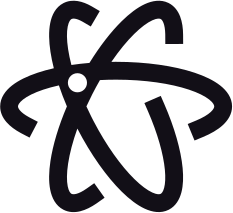
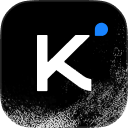

[English](README.md) · [한국어](README.ko.md) · [简体中文](README.zh-CN.md) · **Français** · [Deutsch](README.de.md)

<p align="center">
  <picture>
    <source media="(prefers-color-scheme: dark)" srcset="assets/taste-skill-wordmark-dark.png" />
    
  </picture>
</p>

<p align="center">
  <a href="https://tasteskill.dev" title="Visiter tasteskill.dev"></a>
  &nbsp;
  <a href="https://tastecode.dev" title="Visiter tastecode.dev"></a>
  &nbsp;
  <a href="LICENSE"></a>
  &nbsp;
  <a href="CHANGELOG.md"></a>
</p>

<p align="center">
  <a href="https://tastecode.dev">
    <picture>
      <source media="(prefers-color-scheme: dark)" srcset="assets/readme-tastecode-dark.webp" />
      
    </picture>
  </a>
</p>

<h3 align="center">Sponsors</h3>

<table align="center">
  <tr>
    <td align="center" width="104">
      <a href="https://interfaces.dev/?utm_source=tasteskill&utm_medium=sponsorship">
        
      </a>
    </td>
    <td><sub><a href="https://interfaces.dev/?utm_source=tasteskill&utm_medium=sponsorship"><strong>interfaces.dev</strong></a> · Un magazine de design engineering par <a href="https://github.com/jakubkrehel"><strong>Jakub Krehel</strong></a></sub></td>
  </tr>
  <tr>
    <td align="center" width="104">
      <a href="https://reactbits.dev">
        <picture>
          <source media="(prefers-color-scheme: dark)" srcset="assets/sponsors/reactbits-icon-dark.svg" />
          
        </picture>
      </a>
    </td>
    <td><sub><a href="https://reactbits.dev"><strong>React Bits</strong></a> · composants React animés pour des interfaces créatives</sub></td>
  </tr>
  <tr>
    <td align="center" width="104"><a href="https://img.ly/"></a></td>
    <td><sub><a href="https://img.ly/"><strong>IMG.LY</strong></a> · CreativeEditor SDK</sub></td>
  </tr>
  <tr>
    <td align="center" width="104"><a href="https://www.sent.dm"></a></td>
    <td><sub><a href="https://www.sent.dm"><strong>Sent.dm</strong></a> · API de messagerie pour SMS, WhatsApp et RCS</sub></td>
  </tr>
</table>

<p align="center"><sub><a href="https://github.com/sponsors/Leonxlnx">Devenir sponsor</a></sub></p>

**Taste Skill** (`tasteskill 2.5.2`) est une Agent Skill qui amène les agents de code à construire des sites d'entreprise professionnels au niveau de `figma.com` et `x.ai`, au lieu d'assembler une landing page générique. Chaque réalisation repose sur un texte simple, un seul système de design, une section par écran, des bords gauche et droit égaux, de vraies photographies (des photos de substitution sous licence quand le client n'en a pas), de vraies icônes de marque et une vraie interface de produit, une entrée de hero et un ou deux temps forts distribués sur chaque page, de discrètes micro-interactions, et des effets shader et des scènes de défilement réservés strictement aux pages tech, gaming et logiciel, le tout vérifié dans un vrai navigateur par un vérificateur et une porte de finition qui font respecter les règles.

Pages construites à partir d'un seul brief lors de précédentes exécutions v2 :

<table>
  <tr>
    <td width="50%"></td>
    <td width="50%"></td>
  </tr>
  <tr>
    <td width="50%"></td>
    <td width="50%"></td>
  </tr>
</table>

Les photographies sont réelles, trouvées dans des archives ouvertes et créditées par la skill ([crédits](examples/v2/CREDITS.md)). Regardez le [film de lancement](https://github.com/Leonxlnx/taste-skill/releases/tag/v2.0.0).

## Installation

```bash
npx skills add https://github.com/Leonxlnx/taste-skill --skill "design-taste-frontend"
```

Cette commande installe la skill avec la CLI [`npx skills`](https://github.com/vercel-labs/agent-skills).

La skill exécute ses scripts avec **Node 22+** et un **Chrome, Edge ou Chromium** installé (définissez `CHROME_PATH` s'il se trouve à un emplacement non standard). Optionnel : **ffmpeg** dans le PATH, pour la sortie WebP et le recadrage mobile d'une photographie de hero dans `photos.mjs`. Elle n'installe rien et ne demande aucune clé d'API. Les photographies Wikimedia Commons fournies fonctionnent hors ligne ; le téléchargement de photographies ou d'icônes supplémentaires utilise le réseau.

<details>
<summary>Plugin Claude Code</summary>

Exécutez ces commandes dans Claude Code. La skill est placée sous l'espace de noms `taste-skill:`, elle n'entre donc pas en conflit avec vos autres skills.

```
/plugin marketplace add Leonxlnx/taste-skill
/plugin install taste-skill@taste-skill
```

`/plugin update` la met à jour par la suite. Sur claude.ai, téléversez le zip du dépôt (**Code > Download ZIP** sur GitHub) dans **Customize > Plugins > Add > Upload plugin**.

</details>

<details>
<summary>Plugin Codex</summary>

```bash
codex plugin marketplace add Leonxlnx/taste-skill
codex plugin add taste-skill@taste-skill
```

Démarrez ensuite une nouvelle session Codex pour que la skill soit chargée.

</details>

<details>
<summary>Depuis un clone, en lien plutôt qu'en copie</summary>

`./install.sh` crée un lien symbolique de la skill vers Claude Code (`--codex` pour Codex, `--all-agents` pour les deux), de sorte qu'un `git pull` la met à jour sur place. Sous Windows (Git Bash), il crée un vrai lien, ou une jonction de répertoire lorsque les liens symboliques ne sont pas autorisés, et il signale un ancien dossier copié au lieu de l'ignorer en silence.

</details>

Vous avez déjà la skill ? Relancez la commande d'installation ; le nom d'installation n'a pas changé. Vous cherchez l'une des anciennes skills ? Voir [Skills déplacées](#skills-déplacées).

## Comment fonctionne la version 2.5

Pour l'utiliser, demandez à votre agent de construire ou de refondre un site d'entreprise ; l'agent charge la skill, copie `assets/` dans le projet, part de `assets/starter.html` et lance le vérificateur avant de rendre la page. Chaque réalisation commence par classer l'activité du client (`software`, `gaming`, `tech`, `product`, `service` ou `place`) et par planifier la page écran par écran avant d'écrire du balisage :

1. **Tirer les tokens et la mise en page.** `scripts/start.mjs` tire une palette adaptée au métier et un couple de polices Google Fonts adapté au type de page (`library/palettes.json`, `library/type.json`), et `assets/layout/deal.mjs` tire une mise en page de hero (`split`, `centred`, `product`, `photo`, `place`, `collage`, `editorial`, `word`, `film`, `statement` ou `triptych`).
2. **Partir d'un seul système.** `assets/starter.html`, `assets/system.css` et `assets/layout/layout.css` imposent une section par écran sur desktop (`1440x900`), des bords de contenu gauche et droit égaux, une barre de navigation fixe et un pied de page de clôture tenant sur un seul écran (`footer.closing`).
3. **Montrer une vraie interface de produit et de vraies photographies.** Les pages logiciel et tech remplissent des cartes de fonctionnalités éclairées (`assets/ui/cards.css`) avec des fragments d'interface HTML réécrits (`assets/ui/`) et des diagrammes de nœuds et de lignes (`assets/diagrams/`), avec de vrais SVG de marques et d'interfaces résolus en local par `scripts/icons.mjs`. Les pages de lieux, de boutiques, d'hôtellerie et de produits non techniques s'ouvrent sur des photographies choisies (`scripts/photos.mjs`, `assets/photos/`), de la typographie et des aplats de couleur, et créditent leurs sources dans une seule ligne dépliable du pied de page, sans légendes sous les images.
4. **Réserver les effets aux pages tech et gaming.** Les fonds shader (`scripts/effects.mjs`), les scènes de défilement (`assets/scenes/`) et les empreintes 3D procédurales (`assets/objects/`) ne sont tirés que sur les pages `software`, `tech` et `gaming`, dans la limite de quatre contextes WebGL, avec des solutions de repli statiques pour les téléphones et pour la réduction des animations. Chaque page reçoit une entrée de hero et un ou deux temps forts issus de `scripts/moments.mjs` ; les cafés, hôtels, boutiques, studios et services n'ont droit qu'à ceux fondés sur la photo et la typographie, et à zéro WebGL.
5. **Vérifier dans un vrai navigateur, en HTTP.** `scripts/consistency.mjs`, `assets/layout/check.mjs`, `scripts/perf.mjs` et `scripts/shoot.mjs` affichent la page construite dans Chrome headless à `1440`, `1024`, `768` et `390`, et détectent les visuels vides, les shaders cassés, les pertes de contraste, les colonnes mal alignées, les écarts de hauteur entre sections, le texte factice, les numéros de rue inventés et les trous d'images sur réseau lent avant la livraison. `scripts/gate.mjs` retient ensuite la finition tant qu'il reste un FAIL corrigeable, trois passes au maximum.

Le détail de ce qui a changé depuis `2.1.x` se trouve dans le [journal des modifications](CHANGELOG.md).

## Les outils

Tout est un simple script Node 22+ dans le dossier de la skill ; aucun n'installe quoi que ce soit.

| Outil | Ce qu'il fait |
| --- | --- |
| `scripts/start.mjs` | Tire une palette et un couple de polices Google Fonts pour le type de page, et affiche les liens `<head>` et les tokens `:root`. |
| `assets/layout/deal.mjs` | Tire l'une des onze mises en page de hero testées ; `assets/layout/check.mjs` la vérifie avec des tests de résistance sur de longs titres. |
| `scripts/photos.mjs` | Tire des photographies validées selon le métier, impose le poids des images et écrit l'unique ligne de crédits du pied de page. |
| `scripts/icons.mjs` | Résout de vraies icônes de marque et d'interface en fichiers SVG locaux. |
| `scripts/effects.mjs`, `scripts/moments.mjs` | Tirent des fonds shader pour les pages tech, gaming et logiciel, et les temps forts pour tous les types de pages. |
| `scripts/gate.mjs`, `scripts/copy-lint.mjs` | La porte de finition (aussi un hook Stop) et le linter de texte qu'elle exécute. |
| `scripts/consistency.mjs` | Le vérificateur : affiche la page dans Chrome headless en HTTP à `1440`, `1024`, `820`, `768` et `390` et indique PASS, WARN ou FAIL pour chaque règle. |
| `scripts/perf.mjs`, `scripts/shoot.mjs` | Poids et vitesse de la page, et captures d'écran de la page entière et de chaque section. |

Premier lancement, depuis le dossier du projet (un tirage arme aussi la porte de finition à cet endroit) : `node scripts/start.mjs deal --page software` (types : `software`, `gaming`, `tech`, `product`, `service`, `place`). Vérifiez une page construite avec `node scripts/consistency.mjs <url or file> --page <kind>`.

## Skills déplacées

Ce dépôt contient une seule skill, `design-taste-frontend`. Les autres ont déménagé dans des dépôts à part et ont gardé leur nom d'installation :

| Nom d'installation | Où elle se trouve maintenant |
| --- | --- |
| `high-end-visual-design`, `minimalist-ui`, `industrial-brutalist-ui`, `gpt-taste`, `stitch-design-taste`, `design-taste-frontend-v1`, `design-taste-frontend-v2-experimental` | **[Leonxlnx/taste-skill-classics](https://github.com/Leonxlnx/taste-skill-classics)** |
| `imagegen-frontend-web`, `imagegen-frontend-mobile`, `brandkit`, `image-to-code` | **[Leonxlnx/imagegen-skills](https://github.com/Leonxlnx/imagegen-skills)** |
| `redesign-existing-projects` | Intégrée à `design-taste-frontend`, qui audite une page existante dans un vrai navigateur avant de rien modifier |
| `full-output-enforcement` | Supprimée. Pour le même problème, voir **[Leonxlnx/unlazy](https://github.com/Leonxlnx/unlazy)** |

Installez une skill déplacée depuis son nouveau dépôt, sous le même nom :

```bash
npx skills add https://github.com/Leonxlnx/taste-skill-classics --skill "high-end-visual-design"
```

## Questions fréquentes

**De quoi la skill a-t-elle besoin ?**
De Node 22 ou plus récent et de Chrome, Edge ou Chromium ; ffmpeg est optionnel (photographies WebP et recadrage mobile d'une photographie de hero). Elle n'installe rien et n'utilise aucune clé d'API. Les photographies Commons fournies sont stockées en local ; le réseau n'est utilisé que pour télécharger des photographies supplémentaires, des Google Fonts ou des icônes de marque.

**D'où viennent les images, et puis-je les utiliser ?**
De la bibliothèque de photographies validées de la skill (`assets/photos/photos.json`, qui comprend des lots WebP Wikimedia Commons fournis et des photographies Unsplash), tirées par `scripts/photos.mjs`. Les images de la bibliothèque servent aux détails de métier et de matière (ou sont explicitement marquées comme substituts provisoires quand le client n'a pas encore de photographies), ne sont jamais présentées comme les locaux, l'équipe ou le produit du client, et sont créditées dans une seule ligne dépliable du pied de page (`photos.mjs credits`).

**Est-ce que ça fonctionne avec React, Vue, Svelte, du HTML simple ?**
Un dossier vide reçoit une page statique issue de `assets/starter.html`. Un projet React, Vue, Svelte, Astro ou Tailwind existant est construit dans sa propre stack, le kit étant servi depuis son dossier public ; un brief Next.js est construit sous forme d'export statique. Les vérifications dans le navigateur s'exécutent sur la page servie ou construite.

**Quand une page reçoit-elle des shaders ou des effets de défilement ?**
Les shaders uniquement sur les pages `software`, `tech` (matériel technique) et `gaming`, et toujours dans un budget de quatre contextes WebGL, avec des solutions de repli statiques pour les téléphones et la réduction des animations. Les lieux, boutiques, cafés, hôtels, studios, services et produits physiques du quotidien restent calmes : des photographies, une typographie nette et des aplats de couleur, avec une entrée de hero et un ou deux temps forts fondés sur la photo ou la typographie dans leurs propres sections.

## Soutenir le projet

Si Taste Skill vous est utile, pensez à le sponsoriser :

[Sponsoriser sur GitHub](https://github.com/sponsors/Leonxlnx)

### Soutiens open source

<table align="center">
  <tr>
    <td align="center" width="104"><a href="https://www.kimi.com"></a></td>
    <td><a href="https://www.kimi.com"><picture><source media="(prefers-color-scheme: dark)" srcset="https://kimi-file.moonshot.cn/prod-chat-kimi/kfs/4/1/2026-06-05/1d8h69mt3v89kkekg24gg" /></picture></a><br /><sub><a href="https://platform.kimi.ai?track_id=track-20f0d64bcaba419bb425a3e8c306f65d&aff=taste-skill"><strong>Obtenir une clé d'API Kimi</strong></a> : les utilisateurs de taste-skill reçoivent 10 % de crédits d'API supplémentaires sur leur premier achat.</sub></td>
  </tr>
  <tr>
    <td align="center" width="104"><a href="https://vercel.com/open-source-program"></a></td>
    <td><a href="https://vercel.com/open-source-program"></a></td>
  </tr>
</table>

### Sponsors de la communauté

<p>
<a href="https://github.com/dnakov"></a>
<a href="https://github.com/AkramReshad"></a>
<a href="https://github.com/ajmalaksar25"></a>
<a href="https://github.com/krikkkk"></a>
<a href="https://github.com/navanchauhan"></a>
<a href="https://github.com/robinebers"></a>
<a href="https://github.com/JKc66"></a>
<a href="https://github.com/u2393696078-rgb"></a>
<a href="https://github.com/a-human-created-this"></a>
<a href="https://github.com/AtharvaJaiswal005"></a>
<a href="https://github.com/ghughes7"></a>
<a href="https://github.com/mccun934"></a>
<a href="https://github.com/techmedic5"></a>
<a href="https://github.com/bytewerk-dev"></a>
<a href="https://github.com/LuisGot"></a>
<a href="https://github.com/oskar-collab"></a>
<a href="https://github.com/denvit"></a>
<a href="https://github.com/onedollarstock"></a>
<a href="https://github.com/KANA-33"></a>
<a href="https://github.com/emilkowalski"></a>
<a href="https://github.com/AnthonyLiuVa"></a>
<a href="https://github.com/Wolfy18"></a>
<a href="https://github.com/Gigslol"></a>
</p>

<p align="center">
 <a href="https://www.star-history.com/leonxlnx/taste-skill">
  <picture>
   <source media="(prefers-color-scheme: dark)" srcset="https://api.star-history.com/badge?repo=Leonxlnx/taste-skill&theme=dark" />
   <source media="(prefers-color-scheme: light)" srcset="https://api.star-history.com/badge?repo=Leonxlnx/taste-skill" />
   
  </picture>
 </a>
</p>

<sub>Retours : ouvrez une issue ou une pull request, écrivez en message privé à [@lexnlin](https://x.com/lexnlin) ou [@blueemi99](https://x.com/blueemi99), ou envoyez un e-mail à [hello@tasteskill.dev](mailto:hello@tasteskill.dev).</sub>

<sub>Taste Skill n'a aucun token, coin ou projet crypto officiel. Tout token utilisant mon nom, mon image ou mon projet n'a aucun lien avec moi et n'est pas approuvé par moi.</sub>

## Licence

[Licence MIT](LICENSE) · Copyright (c) 2026 Leonxlnx
