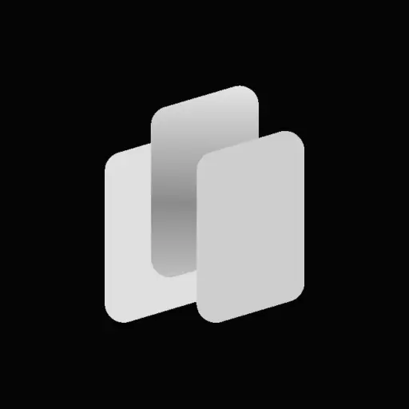
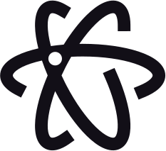
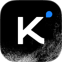

[English](README.md) · **한국어**

<p align="center">
  <picture>
    <source media="(prefers-color-scheme: dark)" srcset="assets/taste-skill-wordmark-dark.png" />
    
  </picture>
</p>

<p align="center">
  <a href="https://tasteskill.dev" title="tasteskill.dev 방문"></a>
  &nbsp;
  <a href="https://tastecode.dev" title="Visit tastecode.dev"></a>
  &nbsp;
  <a href="LICENSE"></a>
  &nbsp;
  <a href="CHANGELOG.md"></a>
</p>

<p align="center">
  <a href="https://tastecode.dev">
    <picture>
      <source media="(prefers-color-scheme: dark)" srcset="assets/readme-tastecode-dark.webp" />
      
    </picture>
  </a>
</p>

<h3 align="center">후원</h3>

<table align="center">
  <tr>
    <td align="center" width="104">
      <a href="https://interfaces.dev/?utm_source=tasteskill&utm_medium=sponsorship">
        
      </a>
    </td>
    <td><sub><a href="https://interfaces.dev/?utm_source=tasteskill&utm_medium=sponsorship"><strong>interfaces.dev</strong></a> · 디자인 엔지니어링 매거진 · 제작: <a href="https://github.com/jakubkrehel"><strong>Jakub Krehel</strong></a></sub></td>
  </tr>
  <tr>
    <td align="center" width="104">
      <a href="https://reactbits.dev">
        <picture>
          <source media="(prefers-color-scheme: dark)" srcset="assets/sponsors/reactbits-icon-dark.svg" />
          
        </picture>
      </a>
    </td>
    <td><sub><a href="https://reactbits.dev"><strong>React Bits</strong></a> · 창의적인 인터페이스를 위한 애니메이션 React 컴포넌트</sub></td>
  </tr>
  <tr>
    <td align="center" width="104"><a href="https://img.ly/"></a></td>
    <td><sub><a href="https://img.ly/"><strong>IMG.LY</strong></a> · CreativeEditor SDK</sub></td>
  </tr>
  <tr>
    <td align="center" width="104"><a href="https://www.sent.dm"></a></td>
    <td><sub><a href="https://www.sent.dm"><strong>Sent.dm</strong></a> · SMS, WhatsApp, RCS용 메시징 API</sub></td>
  </tr>
</table>

<p align="center"><sub><a href="https://github.com/sponsors/Leonxlnx">후원하기</a></sub></p>

**Taste Skill** (`tasteskill 2.5.0`)은 코딩 에이전트가 흔한 랜딩 페이지 대신 `figma.com`, `x.ai` 수준의 전문적인 기업 웹사이트를 만들도록 돕는 에이전트 스킬입니다. 모든 작업에 쉬운 문구, 하나의 디자인 시스템, 화면당 하나의 섹션, 좌우가 맞춰진 콘텐츠 경계, 실제 사진과 브랜드 아이콘, 실제 제품 UI를 사용합니다. 제품 사진이 없으면 제품 렌더링 이미지를 사용하고, 미세한 인터랙션은 절제합니다. 셰이더 효과, 독창적인 인터랙션과 스크롤 장면은 기술·게임·소프트웨어 페이지에만 적용합니다. 검사 도구가 실제 브라우저에서 이 규칙들을 확인합니다.

이전 v2 실행에서 하나의 작업 요청서로 만든 페이지입니다.

<table>
  <tr>
    <td width="50%"></td>
    <td width="50%"></td>
  </tr>
  <tr>
    <td width="50%"></td>
    <td width="50%"></td>
  </tr>
</table>

사진은 공개 아카이브에서 찾은 실제 사진이며, 스킬이 출처를 표기합니다([사진 출처](examples/v2/CREDITS.md)). [출시 영상](https://github.com/Leonxlnx/taste-skill/releases/tag/v2.0.0)도 확인해 보세요.

## 설치

```bash
npx skills add https://github.com/Leonxlnx/taste-skill --skill "design-taste-frontend"
```

[`npx skills`](https://github.com/vercel-labs/agent-skills) CLI로 스킬을 설치합니다.

스크립트를 실행하려면 **Node 22 이상**과 **Chrome, Edge 또는 Chromium**이 설치되어 있어야 합니다. 브라우저가 일반적인 경로에 없으면 `CHROME_PATH`를 설정하세요. 선택 사항으로, PATH에 **ffmpeg**가 있으면 `photos.mjs`에서 WebP 출력과 히어로 이미지(페이지 첫 화면의 대표 이미지)의 모바일용 자르기를 사용할 수 있습니다. 스킬 자체는 별도 프로그램을 설치하지 않으며 API 키도 필요하지 않습니다. 함께 제공되는 Wikimedia Commons 사진은 오프라인에서도 사용할 수 있습니다. 사진이나 아이콘을 추가로 가져올 때는 네트워크 연결이 필요합니다.

<details>
<summary>Claude Code 플러그인</summary>

Claude Code 안에서 다음 명령을 실행하세요. 스킬에는 `taste-skill:` 네임스페이스가 붙으므로 다른 스킬과 이름이 겹치지 않습니다.

```
/plugin marketplace add Leonxlnx/taste-skill
/plugin install taste-skill@taste-skill
```

`/plugin update`로 나중에 업데이트할 수 있습니다.

</details>

<details>
<summary>Codex 플러그인</summary>

```bash
codex plugin marketplace add Leonxlnx/taste-skill
codex plugin add taste-skill@taste-skill
```

설치 후 새 Codex 세션을 시작하면 스킬이 로드됩니다.

</details>

<details>
<summary>복제한 저장소에서 복사 대신 링크로 연결하기</summary>

`./install.sh`는 Claude Code에 스킬의 심볼릭 링크를 만듭니다. Codex에는 `--codex`, 둘 다 연결하려면 `--all-agents`를 사용하세요. 이후 `git pull`만 실행하면 연결된 스킬도 업데이트됩니다. Windows(Git Bash)에서는 실제 링크를 만들고, 심볼릭 링크가 허용되지 않으면 디렉터리 정션을 사용합니다. 이전에 복사해 설치한 폴더가 있으면 조용히 건너뛰지 않고 알려 줍니다.

</details>

이미 설치했다면 설치 명령을 다시 실행하세요. 설치 이름은 바뀌지 않았습니다. 이전 스킬을 찾고 있다면 [이전된 스킬](#moved-skills)을 확인하세요.

## 2.5의 동작 방식

에이전트에게 기업 사이트를 만들거나 새로 디자인해 달라고 요청하세요. 에이전트는 스킬을 로드하고 `assets/`를 프로젝트에 복사한 뒤, `assets/starter.html`에서 작업을 시작합니다. 페이지를 전달하기 전에 검사 도구를 실행합니다. 모든 작업은 고객의 업종을 분류하고(`software`, `gaming`, `tech`, `product`, `service`, `place`), 마크업을 작성하기 전에 화면별 구성을 계획하는 것으로 시작합니다.

1. **디자인 토큰과 레이아웃을 무작위로 선택합니다.** `scripts/start.mjs`가 페이지 유형에 맞는 팔레트와 Google Fonts 글꼴 조합을 선택합니다(`library/palettes.json`, `library/type.json`). `assets/layout/deal.mjs`는 히어로 레이아웃을 선택합니다(`split`, `centred`, `product`, `photo`, `place`, `collage`, `editorial`, `word`, `film`, `statement`, `triptych`).
2. **하나의 디자인 시스템에서 시작합니다.** `assets/starter.html`, `assets/system.css`, `assets/layout/layout.css`가 데스크톱(`1440x900`)에서 화면당 하나의 섹션, 좌우가 맞춰진 콘텐츠 경계, 고정 내비게이션 바, 한 화면을 차지하는 마무리 푸터(`footer.closing`)를 적용합니다.
3. **실제 제품 UI와 실제 사진을 보여 줍니다.** 소프트웨어·기술 페이지는 조명 효과가 있는 기능 소개 카드(`assets/ui/cards.css`)에 수정한 HTML UI 조각(`assets/ui/`)과 노드·연결선 다이어그램(`assets/diagrams/`)을 넣습니다. 실제 브랜드·인터페이스 SVG는 `scripts/icons.mjs`로 찾아 로컬 파일로 저장합니다. 장소·상점·숙박 및 접객업·비기술 제품 페이지는 선별한 사진(`scripts/photos.mjs`, `assets/photos/`), 타이포그래피, 단색을 중심으로 구성합니다. 이미지 아래에 캡션을 붙이지 않고, 푸터의 펼칠 수 있는 한 줄에 출처를 모아 표기합니다.
4. **시각 효과는 기술·게임 페이지에만 사용합니다.** 셰이더 배경(`scripts/effects.mjs`), 독창적인 스크롤·포인터 인터랙션(`scripts/moments.mjs`), 스크롤 장면(`assets/scenes/`), 절차적으로 생성한 3D 출력물(`assets/objects/`)은 `software`, `tech`, `gaming` 페이지에만 배정합니다. WebGL 컨텍스트는 최대 네 개로 제한하며, 모바일과 모션 줄이기 설정에서는 정적인 대체 화면을 제공합니다. 카페·호텔·상점·스튜디오·서비스 페이지에는 WebGL이나 스크롤 효과를 사용하지 않습니다.
5. **실제 브라우저에서 HTTP로 검사합니다.** `scripts/consistency.mjs`, `assets/layout/check.mjs`, `scripts/perf.mjs`, `scripts/shoot.mjs`가 완성된 페이지를 헤드리스 Chrome에서 `1440`, `1024`, `768`, `390` 너비로 렌더링합니다. 공개 전에 비어 있는 시각 요소, 작동하지 않는 셰이더, 낮아진 대비, 열 정렬 오류, 섹션 높이 불일치, 임시 문구, 지어낸 번지, 느린 네트워크에서 이미지가 빠지는 문제를 찾아냅니다.

`2.1.x`에서 달라진 내용은 [변경 기록](CHANGELOG.md)을 확인하세요.

## 도구

모두 스킬 폴더 안의 일반 Node 22 이상용 스크립트이며, 별도 프로그램을 설치하지 않습니다.

| 도구 | 기능 |
| --- | --- |
| `scripts/start.mjs` | 페이지 유형에 맞는 팔레트와 Google Fonts 글꼴 조합을 무작위로 선택하고 `<head>` 링크와 `:root` 토큰을 출력합니다. |
| `assets/layout/deal.mjs` | 검증된 히어로 레이아웃 열한 개 중 하나를 무작위로 선택합니다. `assets/layout/check.mjs`는 긴 제목으로 레이아웃을 점검합니다. |
| `scripts/photos.mjs` | 업종에 맞게 검토된 사진을 무작위로 선택하고, 이미지 용량 제한을 적용하며, 푸터에 넣을 출처 한 줄을 작성합니다. |
| `scripts/icons.mjs` | 실제 브랜드·인터페이스 아이콘을 찾아 로컬 SVG 파일로 저장합니다. |
| `scripts/effects.mjs`, `scripts/moments.mjs` | 기술·게임·소프트웨어 페이지에 쓸 셰이더 배경과 독창적인 인터랙션을 무작위로 선택합니다. |
| `scripts/consistency.mjs` | 검사 도구입니다. HTTP로 페이지를 열어 헤드리스 Chrome에서 `1440`, `1024`, `768`, `390` 너비로 렌더링하고, 규칙별로 PASS, WARN, FAIL을 출력합니다. |
| `scripts/perf.mjs`, `scripts/shoot.mjs` | 페이지 용량과 속도를 측정하고, 전체 페이지와 섹션별 스크린샷을 촬영합니다. |

먼저 `node scripts/start.mjs deal --page software`를 실행하세요. 유형은 `software`, `gaming`, `tech`, `product`, `service`, `place`입니다. 완성된 페이지는 `node scripts/consistency.mjs <url or file> --page <kind>`로 검사합니다.

<a id="moved-skills"></a>

## 이전된 스킬

이 저장소에는 `design-taste-frontend` 스킬 하나가 있습니다. 다른 스킬은 각각 별도 저장소로 이전했으며 설치 이름은 유지됩니다.

| 설치 이름 | 현재 위치 |
| --- | --- |
| `high-end-visual-design`, `minimalist-ui`, `industrial-brutalist-ui`, `gpt-taste`, `stitch-design-taste`, `design-taste-frontend-v1`, `design-taste-frontend-v2-experimental` | **[Leonxlnx/taste-skill-classics](https://github.com/Leonxlnx/taste-skill-classics)** |
| `imagegen-frontend-web`, `imagegen-frontend-mobile`, `brandkit`, `image-to-code` | **[Leonxlnx/imagegen-skills](https://github.com/Leonxlnx/imagegen-skills)** |
| `redesign-existing-projects` | `design-taste-frontend`에 통합되었습니다. 변경 전에 실제 브라우저에서 기존 페이지를 점검합니다. |
| `full-output-enforcement` | 삭제되었습니다. 같은 문제를 다루는 **[Leonxlnx/unlazy](https://github.com/Leonxlnx/unlazy)**를 참고하세요. |

이전된 스킬은 새 저장소에서 같은 이름으로 설치하세요.

```bash
npx skills add https://github.com/Leonxlnx/taste-skill-classics --skill "high-end-visual-design"
```

## 자주 묻는 질문

**무엇이 필요한가요?**  
Node 22 이상과 Chrome, Edge 또는 Chromium이 필요합니다. ffmpeg는 선택 사항으로, 사진의 WebP 변환과 히어로 이미지의 모바일용 자르기에 사용합니다. 스킬 자체는 별도 프로그램을 설치하지 않으며 API 키도 사용하지 않습니다. 함께 제공되는 Commons 사진은 로컬에 저장됩니다. 네트워크 연결은 사진, Google Fonts 글꼴, 브랜드 아이콘을 추가로 다운로드할 때만 사용합니다.

**사진은 어디서 가져오며, 사용해도 되나요?**  
검토를 거친 스킬의 사진 라이브러리(`assets/photos/photos.json`)에서 `scripts/photos.mjs`가 선택합니다. 라이브러리에는 함께 제공되는 Wikimedia Commons WebP 사진 모음과 Unsplash 사진이 포함됩니다. 이 사진은 업종이나 소재의 세부 모습을 보여 주는 데 사용하며, 고객 사진이 아직 없을 때는 초안용 대체 사진임을 명확히 표시합니다. 고객의 실제 공간·직원·제품 사진인 것처럼 제시하지 않습니다. 출처는 푸터의 펼칠 수 있는 한 줄에 표기합니다(`photos.mjs credits`).

**React, Vue, Svelte, 일반 HTML에서도 사용할 수 있나요?**  
네. `assets/starter.html`과 모듈식 CSS/JS 도구를 그대로 사용해 배포할 수 있습니다. 같은 디자인 토큰, 섹션의 크기와 배치, UI 조각, 브라우저 검사를 React, Next.js, Vue, Svelte, Astro, Tailwind로 옮겨 사용할 수도 있습니다.

**어떤 페이지에 셰이더나 스크롤 효과를 사용하나요?**  
`software`, `tech`(기술 하드웨어), `gaming` 페이지에만 사용합니다. 항상 WebGL 컨텍스트 네 개 이내로 제한하며, 모바일과 모션 줄이기 설정에서는 정적인 대체 화면을 제공합니다. 장소·상점·카페·호텔·스튜디오·서비스·일반 실물 제품 페이지는 사진, 선명한 타이포그래피, 단색으로 차분하게 구성합니다.

## 프로젝트 후원

Taste Skill이 도움이 되었다면 후원을 고려해 주세요.

[GitHub에서 후원하기](https://github.com/sponsors/Leonxlnx)

### 오픈 소스 지원

<table align="center">
  <tr>
    <td align="center" width="104"><a href="https://www.kimi.com"></a></td>
    <td><a href="https://www.kimi.com"><picture><source media="(prefers-color-scheme: dark)" srcset="https://kimi-file.moonshot.cn/prod-chat-kimi/kfs/4/1/2026-06-05/1d8h69mt3v89kkekg24gg" /></picture></a><br /><sub><a href="https://platform.kimi.ai?track_id=track-20f0d64bcaba419bb425a3e8c306f65d&aff=taste-skill"><strong>Kimi API 키 받기</strong></a>: taste-skill 사용자는 첫 구매 시 API 크레딧 10%를 추가로 받습니다.</sub></td>
  </tr>
  <tr>
    <td align="center" width="104"><a href="https://vercel.com/open-source-program"></a></td>
    <td><a href="https://vercel.com/open-source-program"></a></td>
  </tr>
</table>

### 커뮤니티 후원자

<p>
<a href="https://github.com/dnakov"></a>
<a href="https://github.com/AkramReshad"></a>
<a href="https://github.com/ajmalaksar25"></a>
<a href="https://github.com/krikkkk"></a>
<a href="https://github.com/navanchauhan"></a>
<a href="https://github.com/robinebers"></a>
<a href="https://github.com/JKc66"></a>
<a href="https://github.com/u2393696078-rgb"></a>
<a href="https://github.com/a-human-created-this"></a>
<a href="https://github.com/AtharvaJaiswal005"></a>
<a href="https://github.com/ghughes7"></a>
<a href="https://github.com/mccun934"></a>
<a href="https://github.com/techmedic5"></a>
<a href="https://github.com/bytewerk-dev"></a>
<a href="https://github.com/LuisGot"></a>
<a href="https://github.com/oskar-collab"></a>
<a href="https://github.com/denvit"></a>
<a href="https://github.com/onedollarstock"></a>
<a href="https://github.com/KANA-33"></a>
<a href="https://github.com/emilkowalski"></a>
<a href="https://github.com/AnthonyLiuVa"></a>
<a href="https://github.com/Wolfy18"></a>
<a href="https://github.com/Gigslol"></a>
</p>

<p align="center">
 <a href="https://www.star-history.com/leonxlnx/taste-skill">
  <picture>
   <source media="(prefers-color-scheme: dark)" srcset="https://api.star-history.com/badge?repo=Leonxlnx/taste-skill&theme=dark" />
   <source media="(prefers-color-scheme: light)" srcset="https://api.star-history.com/badge?repo=Leonxlnx/taste-skill" />
   
  </picture>
 </a>
</p>

<sub>의견을 보내려면 이슈나 풀 리퀘스트를 열거나, 다음 계정에 DM을 보내 주세요: [@lexnlin](https://x.com/lexnlin) 또는 [@blueemi99](https://x.com/blueemi99). 이메일: [hello@tasteskill.dev](mailto:hello@tasteskill.dev).</sub>

<sub>Taste Skill에는 공식 토큰·코인·암호화폐 프로젝트가 없습니다. 제 이름·이미지·프로젝트를 사용하는 토큰은 저와 관련이 없으며, 제가 보증하지도 않습니다.</sub>

## 라이선스

[MIT 라이선스](LICENSE) · Copyright (c) 2026 Leonxlnx
