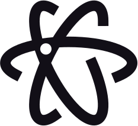
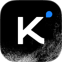

<p align="center">
  <picture>
    <source media="(prefers-color-scheme: dark)" srcset="assets/taste-skill-wordmark-dark.png" />
    
  </picture>
</p>

<p align="center">
  <a href="https://tasteskill.dev" title="Visit tasteskill.dev"></a>
  &nbsp;
  <a href="https://tastecode.dev" title="Visit tastecode.dev"></a>
  &nbsp;
  <a href="LICENSE"></a>
  &nbsp;
  <a href="CHANGELOG.md"></a>
</p>

<p align="center">
  <a href="https://tastecode.dev">
    <picture>
      <source media="(prefers-color-scheme: dark)" srcset="assets/readme-tastecode-dark.webp" />
      
    </picture>
  </a>
</p>

<h3 align="center">Sponsors</h3>

<table align="center">
  <tr>
    <td align="center" width="104">
      <a href="https://interfaces.dev/?utm_source=tasteskill&utm_medium=sponsorship">
        
      </a>
    </td>
    <td><sub><a href="https://interfaces.dev/?utm_source=tasteskill&utm_medium=sponsorship"><strong>interfaces.dev</strong></a> · A design engineering magazine by <a href="https://github.com/jakubkrehel"><strong>Jakub Krehel</strong></a></sub></td>
  </tr>
  <tr>
    <td align="center" width="104">
      <a href="https://reactbits.dev">
        <picture>
          <source media="(prefers-color-scheme: dark)" srcset="assets/sponsors/reactbits-icon-dark.svg" />
          
        </picture>
      </a>
    </td>
    <td><sub><a href="https://reactbits.dev"><strong>React Bits</strong></a> · animated React components for creative interfaces</sub></td>
  </tr>
  <tr>
    <td align="center" width="104"><a href="https://img.ly/"></a></td>
    <td><sub><a href="https://img.ly/"><strong>IMG.LY</strong></a> · CreativeEditor SDK</sub></td>
  </tr>
  <tr>
    <td align="center" width="104"><a href="https://www.sent.dm"></a></td>
    <td><sub><a href="https://www.sent.dm"><strong>Sent.dm</strong></a> · messaging APIs for SMS, WhatsApp, and RCS</sub></td>
  </tr>
</table>

<p align="center"><sub><a href="https://github.com/sponsors/Leonxlnx">Become a sponsor</a></sub></p>

**Taste Skill** (`tasteskill 2.5.0`) is an Agent Skill that makes coding agents build professional company websites at the `figma.com` and `x.ai` level instead of assembling a generic landing page. Every build uses plain copy, one design system, one section per screen, equal left and right edges, real photographs, real brand icons and real product UI, with product renders when a product has no photographs, quiet micro-interactions, and shader effects, creative moments and scroll scenes kept strictly for tech, gaming and software pages, all verified in a real browser by a checker that enforces the rules.

Pages built from a single brief in earlier v2 runs:

<table>
  <tr>
    <td width="50%"></td>
    <td width="50%"></td>
  </tr>
  <tr>
    <td width="50%"></td>
    <td width="50%"></td>
  </tr>
</table>

The photographs are real, found in open archives and credited by the skill ([credits](examples/v2/CREDITS.md)). Watch the [launch film](https://github.com/Leonxlnx/taste-skill/releases/tag/v2.0.0).

## Install

```bash
npx skills add https://github.com/Leonxlnx/taste-skill --skill "design-taste-frontend"
```

That installs the skill with the [`npx skills`](https://github.com/vercel-labs/agent-skills) CLI.

The skill runs its scripts with **Node 22+** and an installed **Chrome, Edge or Chromium** (set `CHROME_PATH` if it is in a non-standard place). Optional: **ffmpeg** on the PATH, for WebP output and the phone crop of a hero photograph in `photos.mjs`. It installs nothing and needs no API keys. Bundled Wikimedia Commons photographs work offline; fetching additional photographs or icons uses network access.

<details>
<summary>Claude Code plugin</summary>

Run these inside Claude Code. The skill is namespaced under `taste-skill:`, so it does not collide with your other skills.

```
/plugin marketplace add Leonxlnx/taste-skill
/plugin install taste-skill@taste-skill
```

`/plugin update` upgrades it later. You can also upload this repository (or its zip) directly as a plugin on Claude.ai via `.claude-plugin/plugin.json`.

</details>

<details>
<summary>Codex plugin</summary>

```bash
codex plugin marketplace add Leonxlnx/taste-skill
codex plugin add taste-skill@taste-skill
```

Start a new Codex session afterwards so the skill is loaded.

</details>

<details>
<summary>From a clone, linked instead of copied</summary>

`./install.sh` symlinks the skill into Claude Code (`--codex` for Codex, `--all-agents` for both), so a `git pull` updates it in place. On Windows (Git Bash) it makes a real link, or a directory junction when symlinks are not allowed, and it reports an older copied folder instead of skipping it silently.

</details>

Already have the skill? Run the install command again; the install name did not change. Looking for one of the older skills? See [Moved skills](#moved-skills).

## How 2.5 works

Use it by asking your agent to build or redesign a company site; the agent loads the skill, copies `assets/` into the project, starts from `assets/starter.html` and runs the checker before it hands the page over. Every build starts by classifying the client's business (`software`, `gaming`, `tech`, `product`, `service` or `place`) and planning the page screen by screen before writing markup:

1. **Deal tokens and layout.** `scripts/start.mjs` deals a palette and Google Fonts pairing for the page kind (`library/palettes.json`, `library/type.json`), and `assets/layout/deal.mjs` deals a hero layout (`split`, `centred`, `product`, `photo`, `place`, `collage`, `editorial`, `word`, `film`, `statement` or `triptych`).
2. **Start from one system.** `assets/starter.html`, `assets/system.css` and `assets/layout/layout.css` enforce one section per screen at desktop (`1440x900`), equal left and right content edges, a fixed navigation bar and a single-screen closing footer (`footer.closing`).
3. **Show real product UI and real photographs.** Software and tech pages populate lit feature cards (`assets/ui/cards.css`) with rewritten HTML UI fragments (`assets/ui/`) and node-and-line diagrams (`assets/diagrams/`), with real brand and interface SVGs resolved locally by `scripts/icons.mjs`. Place, shop, hospitality and non-technical product pages lead with curated photographs (`scripts/photos.mjs`, `assets/photos/`), typography and flat colour, crediting sources in one expandable footer line with no captions under images.
4. **Keep effects for tech and gaming pages.** Shader grounds (`scripts/effects.mjs`), creative scroll or pointer moments (`scripts/moments.mjs`), scroll scenes (`assets/scenes/`) and procedural 3D prints (`assets/objects/`) are dealt only on `software`, `tech` and `gaming` pages within a four-context WebGL cap, with static fallbacks for phones and reduced motion. Cafes, hotels, shops, studios and services get zero WebGL or scroll effects.
5. **Check in a real browser over HTTP.** `scripts/consistency.mjs`, `assets/layout/check.mjs`, `scripts/perf.mjs` and `scripts/shoot.mjs` render the built page in headless Chrome across `1440`, `1024`, `768` and `390`, catching empty visuals, broken shaders, contrast drops, misaligned columns, section-height drift, placeholder text, invented street numbers and slow-network image gaps before the build ships.

Details of what changed from `2.1.x` are in the [changelog](CHANGELOG.md).

## The tools

Everything is a plain Node 22+ script in the skill folder; none installs anything.

| Tool | What it does |
| --- | --- |
| `scripts/start.mjs` | Deals a palette and a Google Fonts pairing for the page kind and prints the `<head>` links and `:root` tokens. |
| `assets/layout/deal.mjs` | Deals one of eleven tested hero layouts; `assets/layout/check.mjs` checks it with long-headline stress tests. |
| `scripts/photos.mjs` | Deals vetted photographs by trade, enforces image weight and writes the one footer credit line. |
| `scripts/icons.mjs` | Resolves real brand and interface icons into local SVG files. |
| `scripts/effects.mjs`, `scripts/moments.mjs` | Deal shader grounds and creative moments for tech, gaming and software pages. |
| `scripts/consistency.mjs` | The checker: renders the page in headless Chrome over HTTP at `1440`, `1024`, `768` and `390` and prints PASS, WARN or FAIL per rule. |
| `scripts/perf.mjs`, `scripts/shoot.mjs` | Page weight and speed, and full-page and per-section screenshots. |

First run: `node scripts/start.mjs deal --page software` (kinds: `software`, `gaming`, `tech`, `product`, `service`, `place`). Check a built page with `node scripts/consistency.mjs <url or file> --page <kind>`.

## Moved skills

This repo holds one skill, `design-taste-frontend`. The others moved to repos of their own and kept their install names:

| Install name | Where it lives now |
| --- | --- |
| `high-end-visual-design`, `minimalist-ui`, `industrial-brutalist-ui`, `gpt-taste`, `stitch-design-taste`, `design-taste-frontend-v1`, `design-taste-frontend-v2-experimental` | **[Leonxlnx/taste-skill-classics](https://github.com/Leonxlnx/taste-skill-classics)** |
| `imagegen-frontend-web`, `imagegen-frontend-mobile`, `brandkit`, `image-to-code` | **[Leonxlnx/imagegen-skills](https://github.com/Leonxlnx/imagegen-skills)** |
| `redesign-existing-projects` | Part of `design-taste-frontend`, which audits an existing page in a real browser before changing anything |
| `full-output-enforcement` | Removed. For the same problem, see **[Leonxlnx/unlazy](https://github.com/Leonxlnx/unlazy)** |

Install a moved skill from its new repo under the same name:

```bash
npx skills add https://github.com/Leonxlnx/taste-skill-classics --skill "high-end-visual-design"
```

## Common Questions

**What does the skill need?**  
Node 22 or newer and Chrome, Edge or Chromium; ffmpeg is optional (WebP photographs and the phone crop of a hero photograph). It installs nothing and uses no API keys. Bundled Commons photographs are stored locally; network access is used only when downloading additional photographs, Google Fonts or brand icons.

**Where do the pictures come from, and can I use them?**  
From the skill's vetted photograph library (`assets/photos/photos.json`, including bundled Wikimedia Commons WebP sets and Unsplash photographs) dealt by `scripts/photos.mjs`. Library frames are used for trade and material details (or marked explicitly as draft stand-ins when the client has no photographs yet), never passed off as the client's own room, staff or product, and credited in one expandable footer line (`photos.mjs credits`).

**Does it work with React, Vue, Svelte, plain HTML?**  
Yes. You can ship directly from `assets/starter.html` and the modular CSS/JS kits, or port the same tokens, section geometry, UI fragments and browser checks into React, Next.js, Vue, Svelte, Astro or Tailwind.

**When does a page get shaders or scroll effects?**  
Only on `software`, `tech` (technical hardware) and `gaming` pages, and always within a four-context WebGL budget with static phone and reduced-motion fallbacks. Places, shops, cafes, hotels, studios, services and everyday physical products stay calm: photographs, sharp typography and flat colour.

## Support the project

If Taste Skill helps you, consider sponsoring:

[Sponsor on GitHub](https://github.com/sponsors/Leonxlnx)

### Open Source Supporters

<table align="center">
  <tr>
    <td align="center" width="104"><a href="https://www.kimi.com"></a></td>
    <td><a href="https://www.kimi.com"><picture><source media="(prefers-color-scheme: dark)" srcset="https://kimi-file.moonshot.cn/prod-chat-kimi/kfs/4/1/2026-06-05/1d8h69mt3v89kkekg24gg" /></picture></a><br /><sub><a href="https://platform.kimi.ai?track_id=track-20f0d64bcaba419bb425a3e8c306f65d&aff=taste-skill"><strong>Get a Kimi API key</strong></a>: taste-skill users get 10% bonus API credits on their first purchase.</sub></td>
  </tr>
  <tr>
    <td align="center" width="104"><a href="https://vercel.com/open-source-program"></a></td>
    <td><a href="https://vercel.com/open-source-program"></a></td>
  </tr>
</table>

### Community Sponsors

<p>
<a href="https://github.com/dnakov"></a>
<a href="https://github.com/AkramReshad"></a>
<a href="https://github.com/ajmalaksar25"></a>
<a href="https://github.com/krikkkk"></a>
<a href="https://github.com/navanchauhan"></a>
<a href="https://github.com/robinebers"></a>
<a href="https://github.com/JKc66"></a>
<a href="https://github.com/u2393696078-rgb"></a>
<a href="https://github.com/a-human-created-this"></a>
<a href="https://github.com/AtharvaJaiswal005"></a>
<a href="https://github.com/ghughes7"></a>
<a href="https://github.com/mccun934"></a>
<a href="https://github.com/techmedic5"></a>
<a href="https://github.com/bytewerk-dev"></a>
<a href="https://github.com/LuisGot"></a>
<a href="https://github.com/oskar-collab"></a>
<a href="https://github.com/denvit"></a>
<a href="https://github.com/onedollarstock"></a>
<a href="https://github.com/KANA-33"></a>
<a href="https://github.com/emilkowalski"></a>
<a href="https://github.com/AnthonyLiuVa"></a>
<a href="https://github.com/Wolfy18"></a>
<a href="https://github.com/Gigslol"></a>
</p>

<p align="center">
 <a href="https://www.star-history.com/leonxlnx/taste-skill">
  <picture>
   <source media="(prefers-color-scheme: dark)" srcset="https://api.star-history.com/badge?repo=Leonxlnx/taste-skill&theme=dark" />
   <source media="(prefers-color-scheme: light)" srcset="https://api.star-history.com/badge?repo=Leonxlnx/taste-skill" />
   
  </picture>
 </a>
</p>

<sub>Feedback: open an issue or pull request, DM [@lexnlin](https://x.com/lexnlin) or [@blueemi99](https://x.com/blueemi99), or email [hello@tasteskill.dev](mailto:hello@tasteskill.dev).</sub>

<sub>Taste Skill has no official token, coin, or crypto project. Any token using my name, image, or project is unaffiliated and not endorsed by me.</sub>

## License

[MIT License](LICENSE) · Copyright (c) 2026 Leonxlnx
