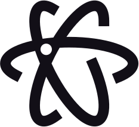
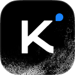

[English](README.md) · [한국어](README.ko.md) · **简体中文** · [Français](README.fr.md) · [Deutsch](README.de.md)

<p align="center">
  <picture>
    <source media="(prefers-color-scheme: dark)" srcset="assets/taste-skill-wordmark-dark.png" />
    
  </picture>
</p>

<p align="center">
  <a href="https://tasteskill.dev" title="访问 tasteskill.dev"></a>
  &nbsp;
  <a href="https://tastecode.dev" title="访问 tastecode.dev"></a>
  &nbsp;
  <a href="LICENSE"></a>
  &nbsp;
  <a href="CHANGELOG.md"></a>
</p>

<p align="center">
  <a href="https://tastecode.dev">
    <picture>
      <source media="(prefers-color-scheme: dark)" srcset="assets/readme-tastecode-dark.webp" />
      
    </picture>
  </a>
</p>

<h3 align="center">赞助者</h3>

<table align="center">
  <tr>
    <td align="center" width="104">
      <a href="https://interfaces.dev/?utm_source=tasteskill&utm_medium=sponsorship">
        
      </a>
    </td>
    <td><sub><a href="https://interfaces.dev/?utm_source=tasteskill&utm_medium=sponsorship"><strong>interfaces.dev</strong></a> · 一本设计工程杂志，作者 <a href="https://github.com/jakubkrehel"><strong>Jakub Krehel</strong></a></sub></td>
  </tr>
  <tr>
    <td align="center" width="104">
      <a href="https://reactbits.dev">
        <picture>
          <source media="(prefers-color-scheme: dark)" srcset="assets/sponsors/reactbits-icon-dark.svg" />
          
        </picture>
      </a>
    </td>
    <td><sub><a href="https://reactbits.dev"><strong>React Bits</strong></a> · 面向创意界面的动画 React 组件</sub></td>
  </tr>
  <tr>
    <td align="center" width="104"><a href="https://img.ly/"></a></td>
    <td><sub><a href="https://img.ly/"><strong>IMG.LY</strong></a> · CreativeEditor SDK</sub></td>
  </tr>
  <tr>
    <td align="center" width="104"><a href="https://www.sent.dm"></a></td>
    <td><sub><a href="https://www.sent.dm"><strong>Sent.dm</strong></a> · 面向 SMS、WhatsApp 和 RCS 的消息 API</sub></td>
  </tr>
</table>

<p align="center"><sub><a href="https://github.com/sponsors/Leonxlnx">成为赞助者</a></sub></p>

**Taste Skill**（`tasteskill 2.5.2`）是一个 Agent Skill，它让编码智能体做出 `figma.com` 和 `x.ai` 水准的专业公司网站，而不是拼凑一个千篇一律的落地页。每次构建都使用朴素的文案、一套设计系统、每屏一个板块、左右对等的边距、真实的照片（客户没有照片时使用有授权的替代照片）、真实的品牌图标和真实的产品界面，每个页面都有一段首屏入场动画和一两个分配好的动效时刻，配以克制的微交互；着色器效果和滚动场景只用于科技、游戏和软件类页面。所有这些都由检查器和收尾关卡在真实浏览器中验证，并强制执行这些规则。

以下页面来自早期 v2 运行，每个都由一份简短的需求生成：

<table>
  <tr>
    <td width="50%"></td>
    <td width="50%"></td>
  </tr>
  <tr>
    <td width="50%"></td>
    <td width="50%"></td>
  </tr>
</table>

这些照片都是真实的，来自开放档案库，并由该 skill 标注了出处（[图片来源](examples/v2/CREDITS.md)）。观看[发布短片](https://github.com/Leonxlnx/taste-skill/releases/tag/v2.0.0)。

## 安装

```bash
npx skills add https://github.com/Leonxlnx/taste-skill --skill "design-taste-frontend"
```

这会通过 [`npx skills`](https://github.com/vercel-labs/agent-skills) CLI 安装该 skill。

该 skill 的脚本需要 **Node 22+** 和已安装的 **Chrome、Edge 或 Chromium**（如果浏览器不在默认位置，请设置 `CHROME_PATH`）。可选：PATH 中的 **ffmpeg**，用于 `photos.mjs` 输出 WebP 以及裁切首屏照片的手机版本。它不会安装任何东西，也不需要 API 密钥。自带的 Wikimedia Commons 照片可离线使用；获取更多照片或图标需要联网。

<details>
<summary>Claude Code 插件</summary>

在 Claude Code 中运行以下命令。该 skill 的命名空间是 `taste-skill:`，因此不会与你的其他 skill 冲突。

```
/plugin marketplace add Leonxlnx/taste-skill
/plugin install taste-skill@taste-skill
```

之后可用 `/plugin update` 升级。在 claude.ai 上，请在 **Customize > Plugins > Add > Upload plugin** 中上传仓库的 zip 文件（GitHub 上的 **Code > Download ZIP**）。

</details>

<details>
<summary>Codex 插件</summary>

```bash
codex plugin marketplace add Leonxlnx/taste-skill
codex plugin add taste-skill@taste-skill
```

之后请新开一个 Codex 会话，以加载该 skill。

</details>

<details>
<summary>从克隆的仓库安装，使用链接而非复制</summary>

`./install.sh` 会把该 skill 以符号链接的方式装入 Claude Code（`--codex` 用于 Codex，`--all-agents` 两者都装），这样 `git pull` 就能原地更新。在 Windows（Git Bash）上，它会创建真正的链接；如果不允许符号链接，则创建目录联接（junction），并且会提示已存在的旧复制文件夹，而不是悄悄跳过。

</details>

已经装过这个 skill？再运行一次安装命令即可，安装名没有变。想找旧版的其他 skill？见[已迁移的 skill](#已迁移的-skill)。

## 2.5 如何工作

使用方式是让你的智能体构建或重新设计一个公司网站；智能体会加载该 skill，把 `assets/` 复制到项目中，从 `assets/starter.html` 开始，并在交付页面之前运行检查器。每次构建都先对客户的业务分类（`software`、`gaming`、`tech`、`product`、`service` 或 `place`），并在编写标记之前按屏规划页面：

1. **分配设计变量与布局。** `scripts/start.mjs` 会分配一套适合该行业的配色，以及一组适合该页面类型的 Google Fonts 字体搭配（`library/palettes.json`、`library/type.json`），`assets/layout/deal.mjs` 则分配一种首屏布局（`split`, `centred`, `product`, `photo`, `place`, `collage`, `editorial`, `word`, `film`, `statement` 或 `triptych`）。
2. **从一套系统起步。** `assets/starter.html`、`assets/system.css` 和 `assets/layout/layout.css` 强制桌面端（`1440x900`）每屏一个板块、内容左右边距对等、固定导航栏，以及单屏的收尾页脚（`footer.closing`）。
3. **展示真实的产品界面和真实的照片。** 软件和科技页面用重写过的 HTML 界面片段（`assets/ui/`）和节点连线图（`assets/diagrams/`）填充带光效的功能卡片（`assets/ui/cards.css`），真实的品牌和界面 SVG 由 `scripts/icons.mjs` 在本地解析。场所、商店、酒店餐饮和非技术类产品页面以精选照片（`scripts/photos.mjs`、`assets/photos/`）、字体排印和纯色为主，出处统一写在一行可展开的页脚里，图片下方不加说明文字。
4. **效果只留给科技和游戏页面。** 着色器背景（`scripts/effects.mjs`）、滚动场景（`assets/scenes/`）和程序化 3D 物件（`assets/objects/`）只会分配给 `software`、`tech` 和 `gaming` 页面，且不超过四个 WebGL 上下文，手机端和减少动态效果的设置下使用静态替代。每个页面都有一段首屏入场动画，以及来自 `scripts/moments.mjs` 的一两个动效时刻；咖啡馆、酒店、商店、工作室和服务类页面只分到以照片和字体为主的那些，完全不使用 WebGL。
5. **通过 HTTP 在真实浏览器中检查。** `scripts/consistency.mjs`、`assets/layout/check.mjs`、`scripts/perf.mjs` 和 `scripts/shoot.mjs` 会在无头 Chrome 中以 `1440`、`1024`、`768` 和 `390` 的宽度渲染构建好的页面，在交付之前找出空白的视觉元素、损坏的着色器、对比度下降、列没有对齐、板块高度漂移、占位文字、编造的街道门牌号，以及慢速网络下的图片缺口。随后 `scripts/gate.mjs` 会一直拦住收尾，直到不再有可修复的 FAIL，最多三轮。

相对 `2.1.x` 的改动详见[更新日志](CHANGELOG.md)。

## 工具

所有工具都是 skill 文件夹里的普通 Node 22+ 脚本，都不会安装任何东西。

| 工具 | 作用 |
| --- | --- |
| `scripts/start.mjs` | 为该页面类型分配一套配色和一组 Google Fonts 字体搭配，并输出 `<head>` 链接和 `:root` 变量。 |
| `assets/layout/deal.mjs` | 分配十一种经过测试的首屏布局之一；`assets/layout/check.mjs` 用超长标题的压力测试来检查它。 |
| `scripts/photos.mjs` | 按行业分配经过筛选的照片，限制图片体积，并写出页脚那一行出处。 |
| `scripts/icons.mjs` | 把真实的品牌和界面图标解析成本地 SVG 文件。 |
| `scripts/effects.mjs`, `scripts/moments.mjs` | 为科技、游戏和软件页面分配着色器背景，并为每种类型分配动效时刻。 |
| `scripts/gate.mjs`, `scripts/copy-lint.mjs` | 收尾关卡（同时也是 Stop hook）及其运行的文案检查器。 |
| `scripts/consistency.mjs` | 检查器：通过 HTTP 在无头 Chrome 中以 `1440`、`1024`、`820`、`768` 和 `390` 的宽度渲染页面，并按规则输出 PASS、WARN 或 FAIL。 |
| `scripts/perf.mjs`, `scripts/shoot.mjs` | 页面体积与速度，以及整页和分板块截图。 |

首次运行，在项目文件夹中执行（分配的同时也会在该文件夹启用收尾关卡）：`node scripts/start.mjs deal --page software`（类型：`software`、`gaming`、`tech`、`product`、`service`、`place`）。检查已构建的页面用 `node scripts/consistency.mjs <url or file> --page <kind>`。

## 已迁移的 skill

这个仓库只包含一个 skill：`design-taste-frontend`。其他 skill 已迁移到各自的仓库，安装名保持不变：

| 安装名 | 现在的位置 |
| --- | --- |
| `high-end-visual-design`, `minimalist-ui`, `industrial-brutalist-ui`, `gpt-taste`, `stitch-design-taste`, `design-taste-frontend-v1`, `design-taste-frontend-v2-experimental` | **[Leonxlnx/taste-skill-classics](https://github.com/Leonxlnx/taste-skill-classics)** |
| `imagegen-frontend-web`, `imagegen-frontend-mobile`, `brandkit`, `image-to-code` | **[Leonxlnx/imagegen-skills](https://github.com/Leonxlnx/imagegen-skills)** |
| `redesign-existing-projects` | 已并入 `design-taste-frontend`，它会在改动之前先在真实浏览器中审查现有页面 |
| `full-output-enforcement` | 已移除。同一问题请参见 **[Leonxlnx/unlazy](https://github.com/Leonxlnx/unlazy)** |

从新仓库按原名安装已迁移的 skill：

```bash
npx skills add https://github.com/Leonxlnx/taste-skill-classics --skill "high-end-visual-design"
```

## 常见问题

**这个 skill 需要什么？**  
Node 22 或更新版本，以及 Chrome、Edge 或 Chromium；ffmpeg 可选（用于 WebP 照片和首屏照片的手机裁切）。它不会安装任何东西，也不使用 API 密钥。自带的 Commons 照片存放在本地；只有下载更多照片、Google Fonts 或品牌图标时才会联网。

**图片从哪里来？我可以使用吗？**  
来自该 skill 经过筛选的照片库（`assets/photos/photos.json`，包含自带的 Wikimedia Commons WebP 图集和 Unsplash 照片），由 `scripts/photos.mjs` 分配。库中的照片用于行业和材质的细节（客户还没有照片时，会明确标注为草稿替代图），绝不冒充客户自己的场地、员工或产品，并在一行可展开的页脚中标注出处（`photos.mjs credits`）。

**它能用于 React、Vue、Svelte 和纯 HTML 吗？**  
空文件夹会从 `assets/starter.html` 得到一个静态页面。已有的 React、Vue、Svelte、Astro 或 Tailwind 项目会在它自己的技术栈中构建，工具包放在其 public 文件夹中提供；Next.js 的需求则构建为静态导出。浏览器检查针对已提供或已构建的页面运行。

**页面什么时候会用到着色器或滚动效果？**  
着色器只用于 `software`、`tech`（技术硬件）和 `gaming` 页面，并且始终控制在四个 WebGL 上下文以内，手机端和减少动态效果的设置下使用静态替代。场所、商店、咖啡馆、酒店、工作室、服务类以及日常实物产品保持平静：照片、清晰的字体排印和纯色，外加一段首屏入场动画，以及在各自板块中以照片或字体为主的一两个动效时刻。

## 支持本项目

如果 Taste Skill 对你有帮助，欢迎赞助：

[在 GitHub 上赞助](https://github.com/sponsors/Leonxlnx)

### 开源支持者

<table align="center">
  <tr>
    <td align="center" width="104"><a href="https://www.kimi.com"></a></td>
    <td><a href="https://www.kimi.com"><picture><source media="(prefers-color-scheme: dark)" srcset="https://kimi-file.moonshot.cn/prod-chat-kimi/kfs/4/1/2026-06-05/1d8h69mt3v89kkekg24gg" /></picture></a><br /><sub><a href="https://platform.kimi.ai?track_id=track-20f0d64bcaba419bb425a3e8c306f65d&aff=taste-skill"><strong>获取 Kimi API 密钥</strong></a>： taste-skill 用户首次购买可获赠 10% 的额外 API 额度。</sub></td>
  </tr>
  <tr>
    <td align="center" width="104"><a href="https://vercel.com/open-source-program"></a></td>
    <td><a href="https://vercel.com/open-source-program"></a></td>
  </tr>
</table>

### 社区赞助者

<p>
<a href="https://github.com/dnakov"></a>
<a href="https://github.com/AkramReshad"></a>
<a href="https://github.com/ajmalaksar25"></a>
<a href="https://github.com/krikkkk"></a>
<a href="https://github.com/navanchauhan"></a>
<a href="https://github.com/robinebers"></a>
<a href="https://github.com/JKc66"></a>
<a href="https://github.com/u2393696078-rgb"></a>
<a href="https://github.com/a-human-created-this"></a>
<a href="https://github.com/AtharvaJaiswal005"></a>
<a href="https://github.com/ghughes7"></a>
<a href="https://github.com/mccun934"></a>
<a href="https://github.com/techmedic5"></a>
<a href="https://github.com/bytewerk-dev"></a>
<a href="https://github.com/LuisGot"></a>
<a href="https://github.com/oskar-collab"></a>
<a href="https://github.com/denvit"></a>
<a href="https://github.com/onedollarstock"></a>
<a href="https://github.com/KANA-33"></a>
<a href="https://github.com/emilkowalski"></a>
<a href="https://github.com/AnthonyLiuVa"></a>
<a href="https://github.com/Wolfy18"></a>
<a href="https://github.com/Gigslol"></a>
</p>

<p align="center">
 <a href="https://www.star-history.com/leonxlnx/taste-skill">
  <picture>
   <source media="(prefers-color-scheme: dark)" srcset="https://api.star-history.com/badge?repo=Leonxlnx/taste-skill&theme=dark" />
   <source media="(prefers-color-scheme: light)" srcset="https://api.star-history.com/badge?repo=Leonxlnx/taste-skill" />
   
  </picture>
 </a>
</p>

<sub>反馈：请提交 issue 或 pull request，私信 [@lexnlin](https://x.com/lexnlin) 或 [@blueemi99](https://x.com/blueemi99)，或发邮件至 [hello@tasteskill.dev](mailto:hello@tasteskill.dev)。</sub>

<sub>Taste Skill 没有任何官方代币、币或加密货币项目。任何使用我的名字、形象或项目名称的代币都与我无关，也未经我认可。</sub>

## 许可证

[MIT 许可证](LICENSE) · Copyright (c) 2026 Leonxlnx
